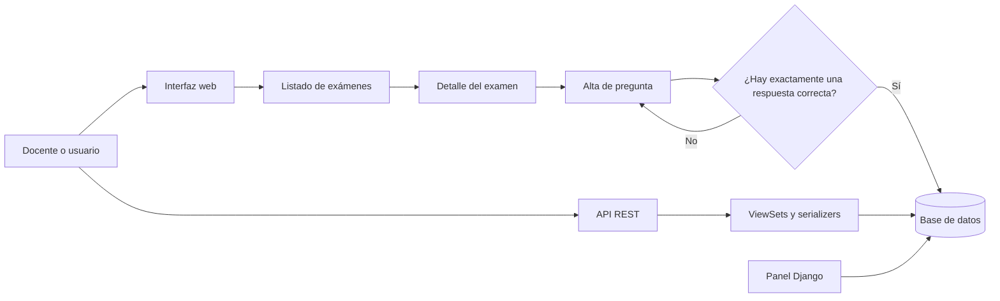
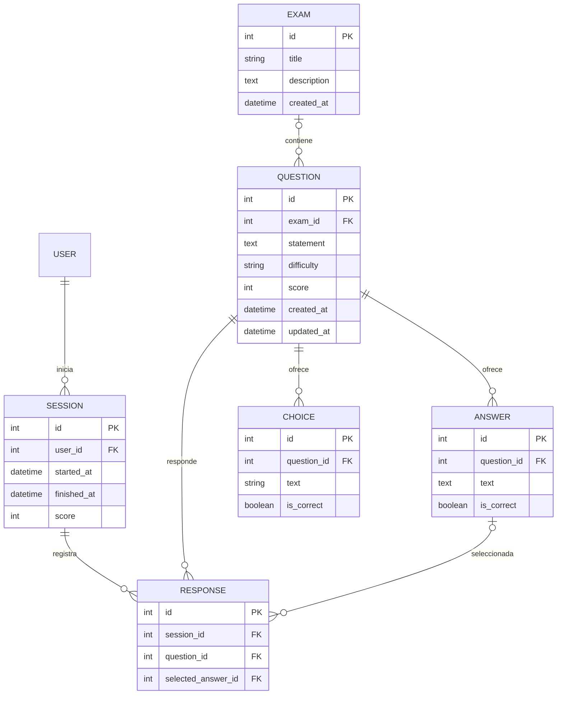

<div align="center">

# Quiz Lab

### Plataforma Django para organizar exámenes y preguntas de selección múltiple

**Interfaz web · API REST · Administración Django**

</div>

---

## ¿Qué es?

Quiz Lab es una aplicación académica construida con Django y Django REST Framework. Su dominio gira alrededor de exámenes, preguntas con alternativas y sesiones de evaluación. Incluye una interfaz web para consultar exámenes y agregar preguntas, una API para exponer los recursos principales y el panel administrativo de Django.

> **Estado del proyecto:** base funcional para gestionar y consultar contenido. La creación de exámenes desde la interfaz y varias escrituras de la API siguen pendientes de completar.

## Lo que incluye

| Área | Funcionalidad disponible |
|---|---|
| Exámenes | Listado ordenado por fecha y vista de detalle con sus preguntas |
| Preguntas | Alta desde un examen, nivel de dificultad y puntaje |
| Alternativas | Formulario con tres filas iniciales y validación de exactamente una respuesta correcta |
| Sesiones | Registro de intentos asociados a un usuario y a un conjunto de preguntas |
| Respuestas | Registro de la alternativa seleccionada por pregunta dentro de una sesión |
| API REST | Rutas para exámenes, preguntas, alternativas, sesiones y respuestas |
| Administración | Gestión de los modelos desde `/admin/` |

## Recorrido de la aplicación



## Modelo de datos



`Question.exam` es opcional en el modelo; las preguntas creadas desde el formulario web se asocian al examen indicado en la URL. `Response` permite una sola respuesta por pregunta y sesión. `Answer` es el modelo que utiliza el formulario de alternativas y al que apunta la respuesta seleccionada; `Choice` también existe en el modelo, pero no es el que usa ese formulario.

## Tecnologías

| Tecnología | Uso |
|---|---|
| Python | Lenguaje del proyecto |
| Django `>=6.0,<7.0` | Aplicación web, ORM, formularios y administración |
| Django REST Framework `>=3.15,<4.0` | API REST y serializers |
| django-environ `>=0.11,<1.0` | Lectura de configuración desde variables de entorno y `.env` |
| SQLite | Base de datos predeterminada para desarrollo |

## Puesta en marcha

Requiere una versión de Python compatible con Django 6 y `pip`.

### Windows PowerShell

```powershell
python -m venv .venv
.\.venv\Scripts\Activate.ps1
python -m pip install -r requirements.txt
python manage.py migrate
python manage.py createsuperuser
python manage.py runserver
```

Luego abre:

- Web: <http://127.0.0.1:8000/exams/>
- API: <http://127.0.0.1:8000/api/>
- Administración: <http://127.0.0.1:8000/admin/>

`createsuperuser` es opcional para explorar la interfaz web; se necesita una cuenta autenticada para crear sesiones por API. La configuración de desarrollo utiliza SQLite por defecto y activa `DEBUG`.

### Otras plataformas

```bash
python -m venv .venv
source .venv/bin/activate
python -m pip install -r requirements.txt
python manage.py migrate
python manage.py runserver
```

### Configuración por entorno

El proyecto lee un archivo `.env` en la raíz. Las variables disponibles en la configuración base son:

| Variable | Valor predeterminado | Descripción |
|---|---|---|
| `SECRET_KEY` | `change-me-in-production` | Clave secreta de Django; debe reemplazarse fuera del entorno local |
| `ALLOWED_HOSTS` | Lista vacía | Hosts permitidos; por ejemplo, `localhost,127.0.0.1` |
| `DATABASE_URL` | `sqlite:///db.sqlite3` | URL de conexión a la base de datos |

Ejemplo mínimo para desarrollo:

```dotenv
SECRET_KEY=una-clave-local-no-publicar
ALLOWED_HOSTS=localhost,127.0.0.1
DATABASE_URL=sqlite:///db.sqlite3
```

Para producción existe `config.settings.production`, que activa opciones de seguridad y logging. Antes de desplegar, configura una clave secreta y hosts reales, prepara la base de datos y verifica el destino de los logs.

## Rutas web

| Método | Ruta | Resultado |
|---|---|---|
| `GET` | `/exams/` | Lista de exámenes |
| `GET` | `/exam/<id>/` | Detalle y preguntas de un examen |
| `GET` | `/exam/<exam_id>/question/new/` | Formulario de alta de pregunta y respuestas |
| `GET` | `/admin/` | Panel de administración de Django |

La vista de lista muestra un botón **New Exam**, pero actualmente es un enlace `#`: todavía no existe un flujo web para crear exámenes. Se pueden administrar desde el panel Django.

## API REST

La API usa el router de DRF bajo `/api/`. Las listas se paginan a 20 elementos por página. Las lecturas son públicas; las escrituras protegidas por la configuración predeterminada requieren autenticación.

| Recurso | Rutas principales | Estado |
|---|---|---|
| Exámenes | `/api/exams/`, `/api/exams/<id>/` | Lectura disponible; serializers de escritura sin persistencia implementada |
| Preguntas | `/api/questions/`, `/api/questions/<id>/` | Lectura disponible; serializers de escritura sin persistencia implementada |
| Respuestas | `/api/answers/`, `/api/answers/<id>/` | Lectura disponible; se pueden filtrar por pregunta usando `?question_pk=<id>`; escritura pendiente de completar |
| Sesiones | `/api/sessions/` | Listado y creación; crear requiere usuario autenticado |
| Respuestas de sesión | `/api/responses/`, `/api/responses/<id>/` | Listado y actualización parcial de la alternativa seleccionada |

Ejemplo de creación de sesión autenticada, indicando preguntas por sus IDs:

```json
{
  "question_ids": [1, 2, 3]
}
```

La actualización parcial de una respuesta acepta `selected_answer_id`:

```json
{
  "selected_answer_id": 4
}
```

En esta etapa, la API no implementa todavía todos los flujos CRUD de forma completa: los serializers de escritura de exámenes, preguntas y respuestas no definen cómo guardar sus modelos. Conviene probar esos métodos antes de integrarlos con un cliente.

## Estructura del proyecto

```text
.
├── config/
│   ├── settings/
│   │   ├── base.py          # Configuración compartida
│   │   ├── development.py   # Ajustes locales
│   │   └── production.py    # Ajustes de despliegue
│   ├── urls.py              # Router de API, administración y web
│   ├── asgi.py
│   └── wsgi.py
├── src/quiz/
│   ├── models.py            # Modelos del dominio
│   ├── forms.py             # Formularios y formset de respuestas
│   ├── views.py             # API y vistas HTML
│   ├── urls.py              # Rutas web
│   ├── admin.py             # Panel de administración
│   └── migrations/          # Historial del esquema
├── templates/quiz/          # Plantillas HTML
├── manage.py
└── requirements.txt
```

## Pruebas

Ejecuta la suite de Django con:

```bash
python manage.py test
```

**Nota sobre el estado de las pruebas:** `src/quiz/tests.py` contiene casos que crean `Question` usando el argumento `text`, mientras que el campo del modelo se llama `statement`. Esos casos necesitan actualizarse para reflejar el modelo actual antes de considerar la suite como una validación verde.

## Próximos pasos naturales

- Implementar la creación y edición de exámenes desde la web.
- Completar los métodos de persistencia de los serializers de escritura.
- Alinear las pruebas con los campos y flujos actuales del dominio.
- Definir validaciones de pertenencia entre sesión, pregunta y respuesta seleccionada.
